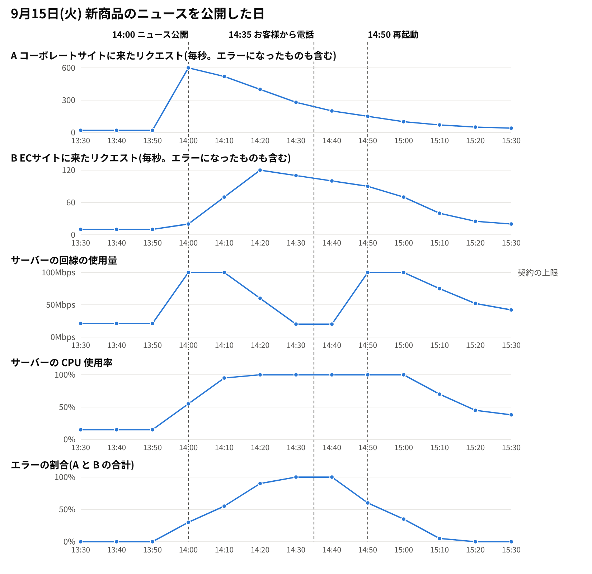
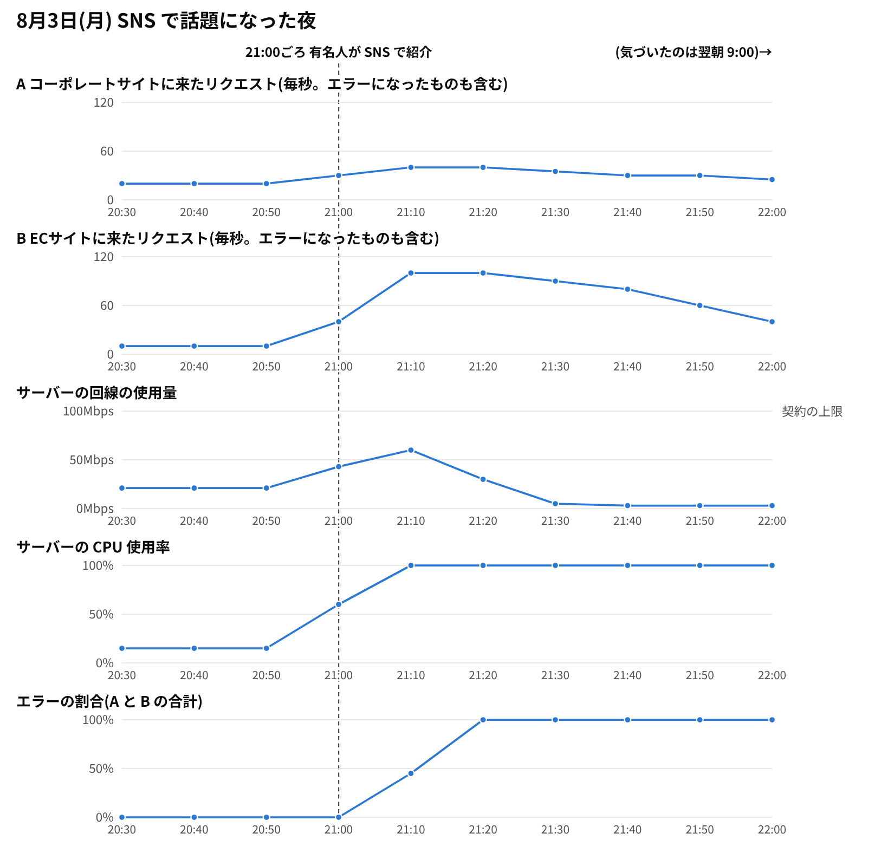

# お客さんの話: ツキノワ製菓(架空)

老舗のお菓子メーカー。株式を上場しています。サイトが2つあり、**同じ1台のサーバー** で動いています。

## 困っていること(担当者の話)

> サイトが **月に2回くらい** 落ちます。たいてい、新商品のニュースや決算(IR)を出した日です。
> 30分から1時間くらい見られなくなって、サーバーを **再起動** すると直ります。
>
> 困るのは、**いちばん売れるときに、お店のサイト(EC)まで落ちる** ことです。ニュースを見た人が、そのまま買いに来てくれるのに。
>
> 8月は、夜に SNS で話題になったときに落ちて、**翌朝出社するまで、だれも気づきませんでした**。
>
> 去年、X社さんに相談して提案書をもらいました。でも、高いわりに「これで本当に落ちなくなるの?」と思って、止まっています。

## 2つのサイト

| | A: コーポレートサイト | B: EC サイト |
| --- | --- | --- |
| 内容 | 会社案内・ニュース・IR(決算の資料) | お菓子の通信販売 |
| 作り | HTML・CSS・JavaScript だけ | **PHP 7.4** + **MySQL 5.7**(会員・注文のデータがある) |
| ふだん | 毎秒 **20** リクエスト | 毎秒 **10** リクエスト |
| ニュース・IR の公開 | 毎秒 **600** リクエスト(**予定が分かっている**。月2回、14:00) | A の公開の **10〜20分後** に、毎秒 **120** リクエスト |
| SNS で話題 | 毎秒 40 リクエスト | 毎秒 **100** リクエスト(**いつ来るか分からない**。年に数回) |
| 1リクエストの大きさ(平均) | 100KB | 60KB |
| 更新 | 広報の2人が、FTP でファイルを上書き | 社内のエンジニア1人 |
| 注文 | — | ふだん 1時間 20万円。**ニュースの後は 1時間 80万円** |

- カード決済は、決済会社の画面で行う(B のサーバーに、カードの番号は来ない)
- 画像は重い。写真の担当者が、撮ったままの大きさで上げている

## 今のサーバー

| 項目 | 内容 |
| --- | --- |
| 場所 | データセンターに **物理サーバー1台**(2019年に購入。8コア・メモリ 16GB) |
| OS など | CentOS 7、Apache、PHP 7.4、MySQL 5.7(**全部この1台** の中) |
| 回線 | **100Mbps** |
| 能力 | PHP の処理は、**毎秒 60 リクエスト** くらいで限界(X社が測った) |
| バックアップ | 毎晩3時に、**同じサーバー** の別のディスクへ |
| 監視 | **なし**。お客様の電話で気づく |
| 保守 | メーカーの保守は **2027年3月** で終わり |
| 費用 | **月 120,000円**(データセンター・回線・保守の合計) |

## グラフ

| | 画像 |
| --- | --- |
| ニュースを公開した日(9月15日) | [graph_news.png](images/graph_news.png) |
| SNS で話題になった夜(8月3日) | [graph_sns.png](images/graph_sns.png) |

## お客さんの希望

- **EC サイトを、売れるときに止めたくない**
- 毎月の費用は **20万円まで**。はじめの費用は **300万円まで**
- 止まったら、**お客様より先に** 気づきたい
- 社内のエンジニアは **1人**(Web の開発が中心。平日 9〜18時)。夜中にサーバーの面倒を見続けるのは無理
- 広報の2人は、Git は使ったことがない。**覚えるのはかまわない**
- **2027年3月** までに、今のサーバーをやめたい

## 計算のヒント

> **回線に必要な量(Mbps)= 毎秒のリクエスト × 1リクエストの大きさ(KB)× 8 ÷ 1000**
> 例: A のふだん → 20 × 100 × 8 ÷ 1000 = **16Mbps**
